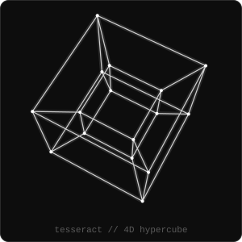

 

<table>
<tr>
<td></td>
<td></td>
</tr>
</table>

## `> whoami`

Developer and first-year university student. About three years of programming, a lot of curiosity about how things work under the hood.
I build my own projects and keep learning: sharpening **Python**, digging deep into **C++**, and moving into **Rust** and **Go**.

## `> stack`

## `> now`

| Language | Status |
| :-- | :-- |
| Python | leveling up |
| C++ | studying in depth |
| Rust | getting started |
| Go | getting started |

## `> activity`

 

